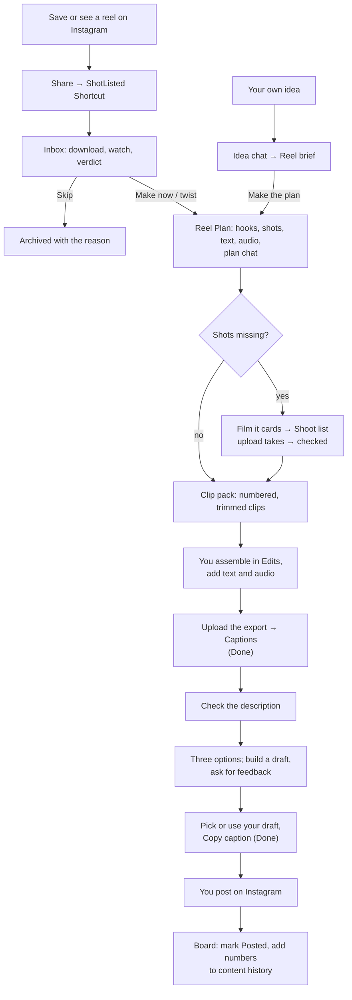

# ShotListed — App Flow

Status legend: **Done** (built, typechecked, tested; not yet deployed), **Partly done**, **Planned**.

## 1. The whole journey

## 2. Screens

| Screen | Path | Status |
| --- | --- | --- |
| Sign in | `/sign-in` | Done |
| Library | `/library` | Done |
| Captions list | `/finals` | Done |
| Caption detail | `/finals/[id]` | Done |
| Settings | `/settings` | Done |
| Inbox | `/inbox` | Done |
| Ideas | `/ideas` | Done |
| Idea chat and brief | `/ideas/[id]` | Done |
| Reel Plan | `/plans/[id]` | Done |
| Shoot list | `/shoot` | Done |
| Board | `/board` | Done |

Navigation (top bar, after sign-in): Inbox · Ideas · Plans · Shoot · Board · Library · Captions · Settings. Also: Inbox, Ideas, Plans, Shoot, Board.

## 3. Flows

### 3.1 Sign in — Done

1. Open the app (tip: Safari → Share → Add to Home Screen).
2. Not signed in → redirected to `/sign-in` (Clerk).
3. Signed in as anyone other than `OWNER_USER_ID` → every API call returns 403.

### 3.2 Add to the library — Done

1. Library → **Add photos and videos** → pick from Photos.
2. Each file shows a progress bar.
   - First **Checking** with a percentage while the phone hashes the file, so identical files are caught before anything is sent.
   - Up to 3 files upload at once.
   - Large videos go in parts and keep going if one part fails.
   - The screen stays awake, and leaving warns you.
3. States per file: Waiting → percentage → **Uploaded** or **Already in library**. Failed → **Retry**; ✕ cancels.
   - An upload that stopped (signal dropped, Safari closed) picks up where it left off when you tap **Retry** or pick the same file again. The bar starts at, say, 90% and only the rest is sent. No second copy is stored.
4. The grid refreshes when uploads settle. The usage bar shows GB used of the 10 GB free tier.
5. Tap an item: full preview, **Download**, **Delete** (removes it from storage, not from your phone).

Also: search in plain words, tag chips you can correct, "exclude from plans".

### 3.2a Duplicates — Done

1. Identical files never get in (3.2). Copies that differ as files but show the same shot are found while indexing.
2. **Same** matches: the newer copy disappears from the grid at once. A banner says "Merged 2 copies of the same shot · Undo" and stays available under Library → **Merged** for 7 days. After that, the better file is kept and the other deleted.
3. **Possible** matches: Library shows **Possible duplicates (n)**. Each pair is side by side with capture time, resolution and size, and a note on which file is better. Choose **Merge** (keeps the better file now) or **Keep both** (never asked again for that pair).
4. A library video that matches a final cut shows **Possible: final cut**. It stays out of plans until you choose **Keep in library** or **Remove**.

### 3.3 Captions from a final cut — Done

1. Captions → **Choose your final cut** → pick the export from Edits. Optionally add notes, such as what the joke is.
2. The video uploads, then the detail page opens with three live steps: **Send to Gemini → Watch and describe → Write captions**. Each shows Running, Done with seconds taken, or Failed.
3. Failed → the error and **Retry from here**.
4. When done, the page shows:
   - **Description**, with **Copy description** and the shot-by-shot view;
   - **Review**: rating, most similar past reel, lesson, one improvement, and a Trial badge (Post as a Trial / Share to everyone) with the reason;
   - **Pick a caption**: three cards with tone label, text, hashtags, keyword chips, and the **Recommended** one with its reason;
   - **Keywords woven in**: each phrase and where it sits;
   - **Not quite?**: type direction, then **New captions** (reuses the description).
5. Tap a card → **Your caption** editor, prefilled with the text and the hashtag line. Edits save automatically.
6. The preview shows exactly what will paste, with counts of characters (out of 2,200) and hashtags (out of 5), and warnings.
7. **Copy caption** → paste into Instagram as is. **Copy hashtags**; **Copy first comment** when hashtags go in the comment.
8. **Delete video** frees storage and keeps the text; **Delete this final cut** removes everything.

### 3.3a Check the description, build a draft, ask for feedback — Done (phase 3b)

Changes to 3.3 once this ships:

1. After **Watch and describe**, the strip shows a fourth step, **Check the description**, marked **Needs you**. The page shows the description as editable fields: the hook, each beat's on-screen text and speech, the full on-screen text list, spoken words, and the call to action. Fix anything the model misread, then tap **Write captions**. (Settings → Captions → **Check the description first** turns this pause off.)
2. The three options appear in full, as now. Under them, **Your draft**:
   - every line of every option has **Add to draft**, and every option's hashtags have **Use these hashtags**;
   - type, paste, drag to reorder, or delete lines; the preview and counts update as you go.
3. **Ask for feedback**, with an optional question ("is line 1 hooky enough?", "too long?"). In 5–20 seconds the reply shows:
   - a verdict and score out of 10;
   - checks against your v3.0 rules: hook, structure, line length, keywords, hashtags, Instagram limits;
   - suggestions, each with **Apply**;
   - the answer to your question.
4. Keep going: edit, ask again, or ask a follow-up. The thread stays with this final cut; **Clear** starts over.
5. **Use this** makes the draft your caption; **Copy caption** works as before.

### 3.4 Settings — Done

1. **Library source**: Upload from my phone / Sync from the Mac mini. Mac status (online if seen in the last 15 minutes, version, items in Photos).
2. **Caption voice**: Social Media Manager prompt and Content history.
   - Save, Discard changes, Restore default.
   - Add each new reel's numbers to the history after posting.
3. **Where hashtags go**: end of caption or first comment. **Blank line before hashtags** (off by default).
4. **Creator profile**, editable with Restore default, used by ideas and plans. **Check the description first** (on by default).

### 3.5 Share a reel — Done

1. In Instagram: Share → **ShotListed** (iOS Shortcut). Optionally type a note.
2. The Shortcut sends the link with `SHORTCUT_TOKEN` and shows "Sent".
3. A phone notification arrives when the verdict is in.

### 3.6 Inbox and verdict — Done

1. Each shared reel appears with a slim progress bar: Downloading → Watching → Scoring.
2. The verdict: **Make now**, **Make with a twist**, or **Skip**, with score and reason.
3. Make → the plan starts automatically. Skip → archived; **Make anyway** overrides.

### 3.6a Your own idea — Done

1. **Ideas → New idea.** Describe it in your own words: "a gym reel where the rest timer is my anime power-up".
2. **Idea chat.** The model asks what it needs (who it's for, the twist, the ending), tells you honestly if the hook is weak or the format is one you posted recently, and suggests variations. Chat as long as you like.
3. **Make the brief.** The conversation becomes a **Reel brief**:
   - title, format, length;
   - the hook;
   - beats: what each shot shows, for how long, its on-screen text and any speech;
   - the sound you have in mind, with search terms.
   Edit any field. Or skip the chat: **Paste a brief** from anywhere and confirm how it was read.
4. A viability score and its reasons show beside the brief, for information only.
5. **Make the plan.** Same as for a shared reel (3.7): clips that fit each beat, Film it cards for the rest, shot order, text, audio, clip pack.

### 3.7 Reel Plan — Done

Plans from a shared reel and from your own brief look the same.

1. The live pipeline diagram at the top, one node per step. Tap a node to see its output.
2. Hooks (3 variants), then the shot list. Per shot:
   - the chosen clip with its fit grade and reason, and alternates (tap to swap);
   - or the Pexels clip with its credit;
   - or a Film it card.
3. On-screen text per shot, each with a copy button. Audio: the inspiration's sound, link and search terms.
4. **Shoot day** label when more than half the shots need filming.
5. **Clip pack** status, then a download link (Photos album with the Mac).
6. **Link final cut**: after editing, upload the export here, so captions also know the plan.
7. **Plan chat**, at the bottom of every plan. Ask for changes in plain words:
   - "swap shots 2 and 3", "make it 15 seconds", "change the text on shot 4 to …": applied at once;
   - "I don't have a gym mirror shot, what else works?": the plan looks for other clips ("Looking for clips…"), then places one graded Exact or Works, or turns the shot into a Film it card and says why.
   Each change makes a new version; **Undo** goes back one.

### 3.8 Film it and takes — Done

1. A Film it card: reference frame, shot, where, framing and lens, movement, text space, light and sound, length to record, two takes.
2. **Upload takes** on the card, or shoot and let the next library sync offer clips recorded after the card was made.
3. Each take is checked: **Pass** (slotted in), **Usable** (with a note), **Reshoot** (the card reopens with the fix). **Use anyway** overrides.
4. The **Shoot list** groups open cards by location across all plans.

### 3.9 Board — Done

Columns Planned → Filming → Editing → Ready to post → Posted. Marking Posted sets the date and feeds format freshness. On a plan, type the numbers, then **Draft a history entry** and **Add to history** (only when you tap) append it to Settings → Content history.

### 3.10 Switch to the Mac mini — Server side Done; agent Planned

1. Install the agent on the Mac and give it `AGENT_TOKEN`.
2. It appears in Settings as Online.
3. Choose **Sync from the Mac mini**. The agent syncs new Photos items; phone uploads still work for takes.
4. Photos you already uploaded from the phone aren't stored again. The agent checks each one first, and ShotListed either attaches the Photos ID to the existing item, or takes the Mac's file if it's better and merges the two (3.2a). Final cuts in the camera roll are skipped.
5. A sync that was interrupted carries on where it stopped.
