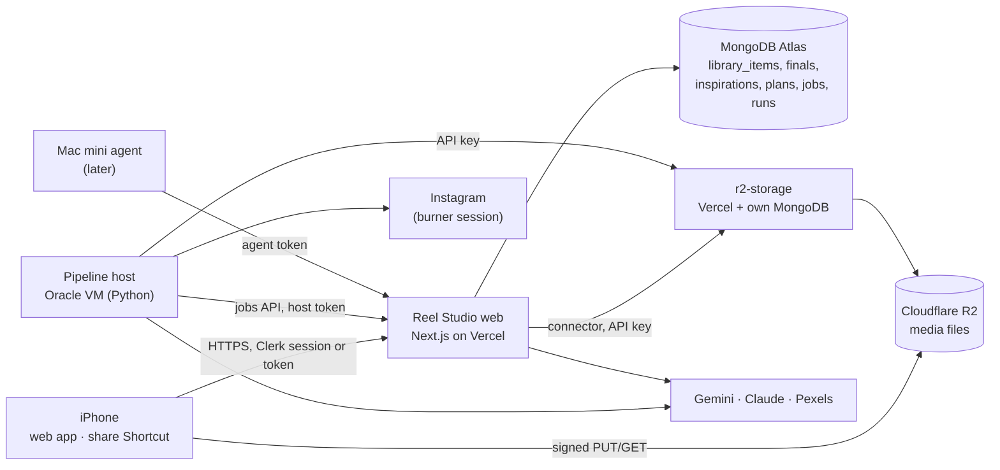

# Reel Studio — Technical Requirements

Status legend: **Done** (built, typechecked, tested; not yet deployed), **Partly done**, **Planned**.

---

## 1. Architecture

| Component | Role | Status |
| --- | --- | --- |
| **Web app** (`web/`) | UI, API, auth, captions engine, job queue | Done for Library, Captions, Settings |
| **Storage service** (separate repo `r2-storage`) | Uploads, duplicates, resuming, asset registry, signed links, derived files, merge, usage | Done (separate repo, see `SPLIT_GUIDE.md`); not deployed |
| **Pipeline host** (`pipeline/`, Oracle VM) | Long media jobs: downloads, ffmpeg, AI calls on video, library tagging | Planned |
| **Mac mini agent** (`pipeline/`, `macsync` command) | Reads iCloud Photos with osxphotos, uploads new items | Server side Done; agent Planned |

## 2. Technology choices

| Area | Choice | Why |
| --- | --- | --- |
| Web framework | Next.js 16 (App Router), React 19, Tailwind 4 | Same stack as CalorieShame; free on Vercel Hobby. Cache Components is turned off: every screen is private and per-user. |
| Auth | Clerk (Core 3), single owner via `OWNER_USER_ID` | Already familiar; no public sign-up. |
| Database | MongoDB Atlas M0 | Document-shaped data (plans, runs); free 512 MB is plenty when media lives in R2. |
| Media storage | `r2-storage` service over Cloudflare R2 | Zero egress fees; one reusable service with per-app keys. |
| Video understanding | Gemini (Files API) | Watches video with its audio, so no ffmpeg keyframes or separate transcription for analysis. |
| Caption writing | Claude (`claude-sonnet-5-5`) when `ANTHROPIC_API_KEY` is set, else Gemini | Your prompt was written for Claude; structured outputs return JSON directly. |
| Pipeline host language | Python 3.12 managed with `uv` | yt-dlp, osxphotos and Playwright are first-class in Python; one language for the host and the Mac agent. |
| Media processing | ffmpeg | Proxies, thumbnails, trims, take checks. |
| Stock footage | Pexels API | Free, 200 requests/hour, 20,000/month; cached. |
| Preview cut (optional) | HyperFrames | Apache 2.0, HTML-based, no company-size licence limit. Replaces Remotion. |

## 3. Web app

### 3.1 Auth — Done

- Pages require a Clerk session (`src/proxy.ts`); API routes check callers themselves (`src/lib/auth.ts`).
- Callers:
  - `owner`: your Clerk session; the user ID must equal `OWNER_USER_ID`.
  - `shortcut`: header `X-Reel-Token: <SHORTCUT_TOKEN>`.
  - `agent`: header `X-Reel-Token: <AGENT_TOKEN>`.
  - `host` (Planned): header `X-Reel-Token: <HOST_TOKEN>`.
- Tokens use `X-Reel-Token`, not `Authorization`, because Clerk reads `Authorization` as its own session token. Comparison is constant-time.
- Unexpected errors return a generic message; details go to Vercel logs.

### 3.2 Uploads — Done (through the storage service)

Reel Studio's upload routes are thin proxies to `r2-storage`. They keep their URLs and request shapes, so the browser, the Shortcut and the Mac agent only ever call Reel Studio. Each route checks the caller (Clerk session or `X-Reel-Token`), adds what Reel Studio decides, and forwards through the connector (§5):

- `purpose` becomes a storage collection: `library` → `library`, `final-cut` → `finals`;
- final cuts get `kinds: ["video"]` and `maxBytes` 500 MB;
- `origin` (`phone-upload`, `mac-photos`, `shortcut`) is stored as metadata;
- Mac uploads must carry the Photos UUID (`externalId`).

Browser side (`src/lib/upload-client.ts`):

- Hashes each file first: SHA-256 with `hash-wasm` (`src/lib/media/hash.ts`), reading `file.slice()` 8 MiB at a time, so a multi-GB video never sits in memory. One file is hashed at a time; uploads run 3 at once. The row shows **Checking** with a percentage. Retry reuses the hash. Hashing runs on the main thread between chunks; move it to a Web Worker only if the page stutters on your phone. Measure the time for a 1 GB video on first deploy.
- `POST /api/media/uploads` with name, type, size and `contentHash`. Replies: `single` (one PUT, files up to 64 MB), `multipart` (8 MiB parts), `duplicate` (same bytes already in that collection, from any device), or `resume` (an unfinished upload of the same file, with the parts R2 already has).
- Multipart: part URLs in batches of 20, 4 parts at a time per file, each retried up to 3 times. Each part's `ETag` is read from the response, so the bucket's CORS rule must expose it.
- `resume`: `planResume` (`src/lib/media/resume.ts`) keeps listed parts of the right size, counts them into the progress bar, sends only the missing ones and completes with all of them.
- A failed upload is kept, so **Retry** or picking the file again resumes. ✕ (cancel) deletes it.
- `GET /api/media/uploads/{id}` returns the resume state, for the Mac agent, which keeps the asset ID between retries.

What storage does with it (rules in the storage repo's `docs/TRD.md` §6): checks the type and size; finds duplicates by Photos UUID, then by hash within the collection; attaches the Mac's Photos UUID to an item the phone uploaded first (`adopted: true`); resumes unfinished uploads on the same item; checks the stored size with R2 on completion; removes uploads untouched for 24 hours.

Different files of the same shot (a JPEG from Safari and the HEIC from the Mac) are Reel Studio's job: §4.1.

### 3.3 Captions engine — Done

Code: `src/lib/captions/`, `src/lib/finals.ts`, `src/app/api/finals/**`.

1. **Watch:** the final cut is read from storage and uploaded to Gemini's Files API; the run waits until the file is `ACTIVE`.
2. **Describe:** Gemini returns structured JSON (`descriptionSchema` in `engine.ts`; prompt `DESCRIBE_SYSTEM`). The Gemini file is deleted afterwards.
3. **Captions:** the system prompt is your prompt, then your content history, then a short engine contract (`ENGINE_CONTRACT`) that maps Section 8 to JSON fields. The reply schema is closed (`additionalProperties: false`, no min/max) so both Claude and Gemini accept it. Code then enforces:
   - at most 3 options;
   - at most 5 hashtags, cleaned and deduped;
   - stray hashtags moved out of the text;
   - recommended option clamped to a valid one.

Runs:

- Steps run inside the request's `after()` on Vercel with `maxDuration = 300` seconds, which is the Hobby ceiling.
- A step still "running" after 6 minutes is shown as failed (cut off by the timeout) and can be retried.
- The page polls every 2 seconds while a step runs.
- A double tap can't start two runs: the first step is marked running before the background work starts.

### 3.3a Description check, caption drafts and feedback — Planned (phase 3b)

Builds on the engine above; needs nothing from the pipeline host, so it can ship before it.

**Description check.**

- A new step `review` sits between `describe` and `captions`. With Settings → Captions → **Check the description first** on (the default), the run stops there with the step in `needs_you`, and the page shows the description as editable fields: hook, each beat's on-screen text and speech, the full on-screen text list, spoken words, call to action.
- **Write captions** saves the edits (`descriptionEdited: true`) and starts `captions`. With the setting off, `review` is `skipped` and the run goes straight through, as today.
- **New captions** and the feedback chat always use the corrected description.

**Drafts.**

- `finals.draft` holds your own caption: `{ lines: string[], hashtags: string[] }`, saved as you edit (same debounce as the selected caption).
- Each line of each option, and each option's hashtag set, has **Add to draft**. Lines can be typed, pasted, moved and deleted. The preview and counts reuse `instagram-format.ts`.
- **Use this** sets `selected` to `{ captionId: "draft", text, hashtags }`, so copying works exactly as for a picked option.

**Feedback.** Prompt and schema: [`prompts/caption-feedback.md`](../prompts/caption-feedback.md).

- `POST /api/finals/{id}/feedback` with `{ draft, question? }`. One model call: Claude when `ANTHROPIC_API_KEY` is set, else Gemini. It typically takes 5–20 seconds, well inside the 300-second limit, so no background step is needed.
- System prompt: your v3.0 prompt, your content history, then a short feedback contract.
- Context: the (corrected) description, the three options, the draft, and the last 10 turns of the thread.
- Reply, as structured JSON:
  - `verdict` (`strong`, `good`, `needs work`) and `score` out of 10;
  - `checks`: `hook`, `structure`, `lineLength`, `keywords`, `hashtags`, `limits`, each `{ ok, note }`;
  - `suggestions`: each `{ id, kind: "replace_line" | "add_line" | "remove_line" | "hashtags", line?, text, why }`;
  - `answer`: free text for your question.
- The schema is closed, as for captions.
- **Apply** on a suggestion edits the draft in the browser; nothing is applied without a tap.
- The thread is stored in `finals.feedback` (each turn has the question, a snapshot of the draft and the reply), capped at 30 turns. **Clear** starts a fresh thread.
- Code checks the model's claims that are checkable: character count, hashtag count, hashtags present, blank lines. Where they disagree, code wins and the reply says so.

### 3.4 Instagram-safe copy — Done

`src/lib/captions/instagram-format.ts`:

- line endings normalised;
- leading and trailing spaces trimmed per line;
- runs of blank lines collapsed to one line holding U+2800 (Braille Pattern Blank);
- hashtags placed on the last line, optionally after a spacer, or left out for the first comment;
- warnings past 2,200 characters or 5 hashtags.

Clipboard uses the Clipboard API with a textarea fallback for older iOS.

### 3.5 Jobs API for the pipeline host — Planned

- The host never connects to Atlas directly; it uses the web app's API with `HOST_TOKEN`:
  - `POST /api/host/jobs/claim` → the next job, leased for 10 minutes;
  - `POST /api/host/jobs/{id}/heartbeat` extends the lease;
  - `POST /api/host/jobs/{id}/complete` or `/fail`.
- Claiming is an atomic `findOneAndUpdate` on `jobs`: `queued → running`, with `leaseUntil`.
- Expired leases go back to `queued`, up to 3 attempts.
- Every step writes events to `runs` (`POST /api/host/runs/{runId}/events`), which drive the live pipeline view.

### 3.6 Live pipeline view — Partly done

- Done: the Captions step strip.
- Planned: a React Flow (`@xyflow/react`) diagram per run, from `runs`. It polls every 2 seconds while anything is active, and each node opens that step's output.

### 3.7 Ideas and plan chat — Planned (phases 8 and 8b)

**One plan input for both routes.** Inspiration analysis and your own ideas both produce a **concept** with the same schema (`conceptSchema`):

- `title`, `format`, `hook`, `lengthSeconds`, `why`;
- `beats[]`, each `{ n, seconds, shows, onScreenText, spoken, sound? }`;
- `onScreenText[]`;
- `audio`: `{ idea, url?, searchTerms[] }`.

The `plan` job takes `{ source: { kind: "inspiration" | "idea", id }, concept }`, so matching, Film it cards, shot order, on-screen text and the clip pack are one code path.

**Idea chat** (`/ideas/{id}`). Prompts: [`prompts/idea-coach.md`](../prompts/idea-coach.md), [`prompts/brief-maker.md`](../prompts/brief-maker.md), [`prompts/viability-judge.md`](../prompts/viability-judge.md), [`prompts/chat-summariser.md`](../prompts/chat-summariser.md).

- `POST /api/ideas/{id}/messages` with `{ text }` → the model's reply. Claude when its key is set, else Gemini.
- The system prompt is an idea-coach contract plus your v3.0 prompt (niche, audience, voice), your content history, and the formats of your last 10 posted plans (for freshness).
- The coach asks questions, pushes back on weak hooks and formats you've used recently, and suggests twists. It never writes the brief until asked.
- **Make the brief** (`POST /api/ideas/{id}/brief`) → one structured call returning a concept. You can edit it field by field, or paste a brief instead (it's parsed into the same shape and you confirm it).
- **Make the plan** queues `plan` with the brief.
- The viability score is computed for ideas too, but only shown: no Skip verdict, **Make anyway** is the default.
- Chats are kept, up to 60 turns; older turns are summarised into one note the model sees.

**Plan chat** (on every plan). Prompts: [`prompts/plan-chat.md`](../prompts/plan-chat.md), [`prompts/chat-summariser.md`](../prompts/chat-summariser.md); `find_clip` uses [`prompts/clip-grader.md`](../prompts/clip-grader.md).

- `POST /api/plans/{id}/messages` with `{ text }`.
- The model sees the plan, the concept, each beat's alternates with their grades, and the Film it cards. It replies with text plus `operations`:
  - `reorder`, `set_length`, `change_text`, `use_alternate`, `make_film_it`, `remove_shot` and `add_shot`;
  - `find_clip`, with a plain-words description of what to look for.
- The server applies the operations that need no search at once and saves a new version (`plans.version` goes up; the previous shot list goes into `plans.history`, last 10 kept). **Undo** restores the previous version.
- `find_clip` operations are queued as a `plan-edit` job for the pipeline host, which runs the same embedding search and grading as `plan` for that beat. The chat shows "Looking for clips…" until it finishes. Weak clips are still never placed: if nothing grades Exact or Works, the beat becomes a Film it card and the reply says so.

### 3.8 Prompts and models

Every model call has one prompt file in [`prompts/`](../prompts/README.md), at the repo root, loaded by both the web app and the pipeline host. Each file holds the system prompt, the user message template (`{{variables}}`), the output schema (`prompts/schemas/*.json`), what code checks or overrides afterwards, and test cases. `web/tests/prompts.test.mts` checks that every file parses, that its variables are declared, and that every schema is closed and accepted by both Claude and Gemini.

| Prompt | Used by | Model |
| --- | --- | --- |
| `DESCRIBE_SYSTEM` (in `engine.ts`) | Captions: describe (§3.3) | video |
| Your v3.0 prompt + `ENGINE_CONTRACT` (in `engine.ts`) | Captions: write (§3.3) | caption |
| `caption-feedback` | Captions: feedback (§3.3a) | caption |
| `library-tagger` | `index-asset` (§4) | vision |
| `inspiration-analysis` | `analyse-inspiration` (§4) | video |
| `viability-judge` | `analyse-inspiration`; ideas (§3.7) | caption |
| `clip-grader` | `plan`, `plan-edit` (§4) | vision |
| `plan-writer` | `plan` (§4) | caption |
| `plan-chat` | Plan chat (§3.7) | caption |
| `idea-coach` | Idea chat (§3.7) | caption |
| `brief-maker` | Make the brief, Paste a brief (§3.7) | caption |
| `chat-summariser` | Long idea and plan chats (§3.7) | cheap |
| `take-checker` | `check-take` (§4) | vision |
| `content-history-writer` | Board → Posted (phase 10, optional) | caption |

Models: `caption` is Claude when `ANTHROPIC_API_KEY` is set, else Gemini; `video` is Gemini through the Files API; `vision` and `cheap` are `VISION_MODEL`.

Your voice comes from Settings, never from the files:

- captions and caption feedback use your **v3.0 prompt** and **Content history**;
- the idea coach, viability judge, plan writer and plan chat use the **Creator profile** (new setting; default drafted in `prompts/creator-profile.default.md`) and your Content history.

That way the caption rules (five lines, hashtags, the Section 8 layout) don't leak into idea chats and plans.

Every stored model result records `promptId` and `promptVersion`, so you can compare before and after a prompt change.

## 4. Pipeline host — Planned

Oracle Cloud Always Free Arm VM (2 OCPU, 12 GB RAM, 200 GB disk) running `pipeline/` as a systemd service. It polls for jobs every 5 seconds.

| Job | What it does |
| --- | --- |
| `index-asset` | Download the original from storage. Recompute its SHA-256 and correct storage if the claimed hash differs. Read capture time, size and duration (exiftool, ffprobe) and compute perceptual hashes (§4.1). Make a 1080p H.264 SDR proxy (videos) and a 512 px thumbnail, upload both as variants. Tag with the vision model ([`prompts/library-tagger.md`](../prompts/library-tagger.md)): caption, setting, shot type, action, mood, quality, people, visible text, unusable. Embed caption, action, objects and uses. Save to `library_items`, then look for copies of the same shot (§4.1). Final cuts get a light version: hashes, duration and frame hashes only. |
| `merge-duplicates` | Daily. Merges `duplicates` whose 7-day undo window has passed (§4.1). |
| `ingest-inspiration` | yt-dlp with the burner's cookies: video, caption, creator, counts, audio name and ID. Store the video in storage (collection `inspirations`). |
| `analyse-inspiration` | Gemini watches it ([`prompts/inspiration-analysis.md`](../prompts/inspiration-analysis.md)): concept (hook, beats, on-screen text, speech, format), emotion, CTA, why it works, what it needs. Then [`prompts/viability-judge.md`](../prompts/viability-judge.md) scores it and code sets the verdict. |
| `plan` | Input: a concept from an inspiration or your own brief (§3.7). Match beats to library items (embedding search, then [`prompts/clip-grader.md`](../prompts/clip-grader.md) grades the top 5: Exact / Works / Weak / No), Pexels for stock-appropriate gaps, Film it cards for the rest. Then [`prompts/plan-writer.md`](../prompts/plan-writer.md) writes hooks, on-screen text, Film it directions, audio and edit notes. |
| `plan-edit` | One beat from the plan chat: search and grade clips ([`prompts/clip-grader.md`](../prompts/clip-grader.md)) for a description, update the plan, post the result to the chat. |
| `clip-pack` | Trim picks with half-second handles, name them `01_hook`, `02_…`, zip, store, link from the plan. |
| `check-take` | ffmpeg checks (orientation, resolution, frame rate, length, darkness, shake), then the vision model ([`prompts/take-checker.md`](../prompts/take-checker.md)) compares keyframes with the card and the reference frame. Pass / Usable / Reshoot. |
| `sync-collection` | Optional. Playwright with the burner's persistent profile on a home machine; slow scrolling, at most 50 scrolls a day. |

Notes:

- Embedding search: brute-force cosine similarity over `library_items` (a few thousand items) in the host. No vector database.
- Instagram blocks data-centre IPs more often. If yt-dlp from the VM gets challenged, run `ingest-inspiration` from a home machine, or upload the reel file by hand (same flow as a final cut).

### 4.1 Recognising the same shot — Planned (phase 6; Mac side phase 12)

Identical files never get stored twice (storage checks content hashes). This covers the rest: one shot saved as two different files, such as the HEIC the Mac exports and the JPEG Safari handed over, or a compressed and an uncompressed copy of a video.

What `index-asset` records per item:

- capture time from the file's metadata, with sub-seconds and time zone when present (EXIF `DateTimeOriginal`, `SubSecTimeOriginal`, `OffsetTimeOriginal`; QuickTime `creationdate` for video);
- width and height after rotation, duration, camera model;
- perceptual hashes (Python `imagehash`, 64-bit pHash): one for a photo; three for a video, from frames at 10%, 50% and 90%.

Finding candidates: same kind, same orientation, capture times within 2 seconds, and for videos durations within 0.5 seconds. An index on `{ kind, "capture.at" }` keeps this to a handful of items.

Verdict:

| Verdict | Rule | What happens |
| --- | --- | --- |
| **Same** | Capture times match to the second, and sub-seconds match when both copies have them. Photo hash distance ≤ 4, or every video frame ≤ 6 with durations within 0.1 s. If either copy has no sub-seconds, distance must be ≤ 2 (protects burst shots, which share a second and look nearly alike). | The newer item is hidden from the Library and plans at once. **Undo** is available for 7 days, then `merge-duplicates` merges them. |
| **Possible** | Within the candidate window and distance ≤ 12. | Both stay. The Library shows **Possible duplicates (n)**: **Merge** or **Keep both** (remembered). |
| Different | Anything else | Nothing. |

Merging:

- The older item's ID is kept, so its tags, exclusions and plans stay attached. Anything that pointed at the newer item (plan shots, takes) is moved to the older one.
- The better file wins: more pixels; then, for video, higher bitrate; then the original format (HEIC or HEVC over a converted JPEG or H.264); a tie keeps the older file.
- Reel Studio calls storage `POST /v1/assets/<older>/merge` with `keepOriginal: "from"` when the newer file is better. If the original changed, the item is re-indexed for new thumbnails and proxy.

Final cuts: Edits saves its exports to your camera roll, so once the Mac syncs, final cuts would reach the library too. A library video that matches a final cut (same hash, or same duration and frame hashes) is marked **Possible: final cut** and excluded from plans until you decide.

Mac mini (phase 12): before uploading, the agent calls `POST /api/agent/match` with the Photos UUID, content hash, capture time, size, duration and its own perceptual hashes. Reel Studio replies:

- `skip` (`already-synced`, `same-bytes`, `final-cut`): for `same-bytes`, the existing item takes the Photos UUID;
- `skip` (`same-shot`): a **Same** match whose file is at least as good; the existing item takes the Photos UUID;
- `upload`: no match, or the Mac's file is better (indexing then merges, keeping the Mac's file), or only a **Possible** match.

## 5. Storage connector — Done

- `web/src/lib/storage/client.ts`: a typed client for the `r2-storage` `/v1` API. Sends `Authorization: Bearer <STORAGE_API_KEY>`; each attempt times out after 15 seconds; `429`, `5xx` and network errors are retried twice with backoff (every call is safe to repeat); failures throw `StorageError` with the service's status and message. No Next.js imports, so `scripts/check-storage.mts` and the tests use it directly.
- `web/src/lib/storage/connector.ts`: server-only; builds the client from env and holds the purpose-to-collection map. The key never reaches the browser.
- `web/src/lib/http.ts`: a storage 4xx passes its message and status through (e.g. "Upload already finished"); a 5xx becomes a 502 with a generic message, details in the logs.
- `web/src/lib/storage/types.ts` follows the storage repo's `openapi.yaml`; update both together.

Reel Studio never reads the storage database directly, only this API; otherwise the two repos would be one system again.

## 6. Limits that shape the design

| Limit | Value | Design response |
| --- | --- | --- |
| Vercel Hobby function duration | 300 s | Captions fit; anything longer runs on the host. |
| Vercel Hobby use | Personal, non-commercial | Upgrade to Pro if Reel Studio is ever sold. |
| Atlas M0 | 512 MB, ~100 ops/s, 500 connections; one free cluster per project; paused after 30 days idle | Reel Studio and r2-storage use separate Atlas projects, so each has its own 512 MB. Text and embeddings only (≈15 KB per item); pool size 5. |
| R2 free tier | 10 GB, 1M writes, 10M reads/month, free egress | Store 1080p proxies; originals can be dropped after proxying. |
| Gemini Files API | 2 GB per file, kept 48 h; URL input only up to 15 MB | Upload through the Files API; delete after describing. |
| Instagram | 5 hashtags, 2,200 characters | Enforced in code. |
| Pexels | 200 requests/hour, 20,000/month | Cache by query in `stock`. |

## 7. Configuration

`web/.env.example` lists every variable:

| Variable | Used for |
| --- | --- |
| `MONGODB_URI`, `MONGODB_DB` | Atlas |
| `NEXT_PUBLIC_CLERK_PUBLISHABLE_KEY`, `CLERK_SECRET_KEY`, `NEXT_PUBLIC_CLERK_SIGN_IN_URL`, `OWNER_USER_ID` | Auth |
| `SHORTCUT_TOKEN`, `AGENT_TOKEN`, `HOST_TOKEN` (Planned) | Non-browser callers |
| `STORAGE_API_URL`, `STORAGE_API_KEY` | Connector (replaces `R2_*`) |
| `GEMINI_API_KEY`, `GEMINI_MODEL` | Video understanding |
| `VISION_MODEL` (Planned, phase 6) | Cheap vision model for tagging, grading and take checks; default Gemini Flash-Lite |
| `ANTHROPIC_API_KEY`, `CLAUDE_MODEL` | Caption writing (optional) |
| `PEXELS_API_KEY` (Planned) | Stock footage |

The pipeline host reads `REEL_STUDIO_URL`, `HOST_TOKEN`, `STORAGE_API_URL`, `STORAGE_API_KEY`, `GEMINI_API_KEY`, `ANTHROPIC_API_KEY`, `PEXELS_API_KEY`, and the path to the burner's cookie file.

## 8. Testing

| Layer | How | Status |
| --- | --- | --- |
| Pure logic (caption engine, Instagram format) | `node --test` | Done |
| Content hash and resume planning (`tests/uploads.test.mts`: SHA-256 test vector, chunked = whole-file hash, cancelling, wrong-size parts re-sent) | `node --test` | Done |
| Storage client (`tests/storage-client.test.mts`: key header, 4xx not retried, retries, 204s, query strings) | `node --test`, `fetch` stubbed | Done |
| Duplicate rules, resuming, the store, S3 round trips | In the r2-storage repo (`npm test`, with moto) | Done there |
| Feedback reply schema accepted by Claude and Gemini; code checks override model claims; suggestions apply to the draft | `node --test` with stubbed models | Planned (phase 3b) |
| Concept schema shared by analysis and briefs; plan-chat operations apply and undo | `node --test` | Planned (phases 8, 8b) |
| Same-shot rules (bursts stay apart, HEIC/JPEG pair is **Same**, recompressed video is **Same**, better file wins, final-cut flag) | `pytest` with fixtures in `pipeline/tests/fixtures/duplicates` | Planned (phase 6) |
| Model calls | Stubbed models in tests; first live run on deploy | Done (stubbed) |
| Connector against a running storage service | `npm run check:storage` | Done against a local storage server; deployed run Planned |
| Pipeline host | `pytest`, with sample media in `pipeline/tests/fixtures` | Planned |
| End-to-end | Checklist in `SPLIT_GUIDE.md` §3 | Planned |

Every change must pass `npm run typecheck && npm run lint && npm test && npm run build`.

## 9. Security

- Private bucket; every view is a signed link (1 hour), every upload a signed PUT (15 minutes) for one exact Content-Type.
- No R2 credentials in Reel Studio after the split; only a revocable storage API key.
- Tokens are long random strings (`openssl rand -hex 32`), compared in constant time.
- The burner account's cookies live only on the machine that downloads reels.
- AI providers receive the video and text you send; use paid tiers to keep it out of training.
